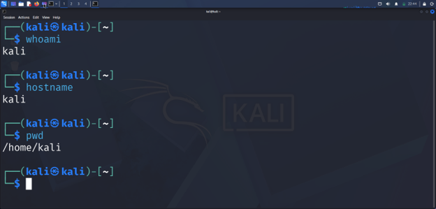
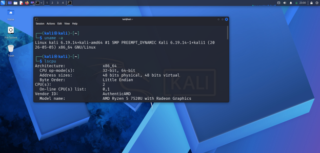
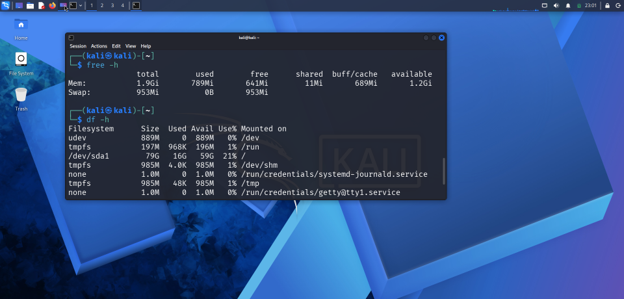
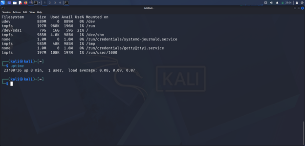
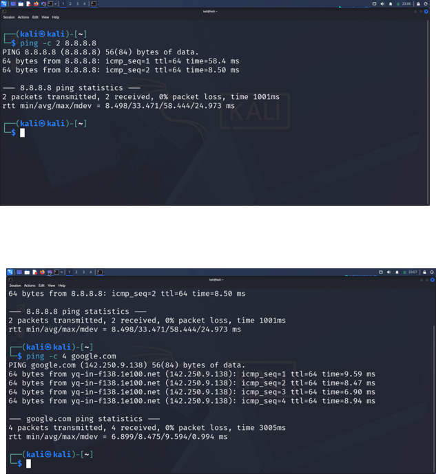

# Linux Fundamentals: System Inspection and Connectivity

[**View or download full report (PDF)**](https://github.com/Bernard-Oteng/CYBERSECURITY-PROJECTS/blob/main/projects/linux-fundamentals/report.pdf)

Public copy with personal identifiers and lab credentials removed.

**Author:** [Bernard Oteng](https://github.com/Bernard-Oteng)  
**Status:** Completed exercise, documented with screenshots  
**Environment:** Kali Linux virtual machine

## Project Overview

I used Linux terminal commands to identify the active user and working directory, inspect system resources, and test network connectivity. The exercise covered system identity, CPU information, memory, storage, uptime, and DNS resolution.

## Tools and Technologies

- Kali Linux virtual machine
- Linux terminal
- `whoami`, `hostname`, `pwd`, `uname`, `lscpu`, `free`, `df`, `uptime`, and `ping`

## Procedure and Findings

### 1. Identify the user and current location

```bash
whoami
hostname
pwd
```

The active username and hostname were both `kali`. The working directory was `/home/kali`.



### 2. Inspect the operating system and CPU

```bash
uname -a
lscpu
```

| Observation | Captured value |
| --- | --- |
| Kernel release | `6.19.14+kali-amd64` |
| Architecture | `x86_64` |
| Supported CPU modes | 32-bit and 64-bit |
| Processor model reported | AMD Ryzen 5 7520U with Radeon Graphics |
| Logical processors visible to the VM | 2, numbered 0 and 1 |

The capture shows only the top of the CPU report; physical core count and clock speed are not established by this evidence.



### 3. Check memory and filesystem space

```bash
free -h
df -h
```

| Resource | Captured result |
| --- | --- |
| Total RAM | 1.9 GiB |
| Available memory | 1.2 GiB |
| Used memory | 789 MiB |
| Swap | 953 MiB total; 0 bytes used |
| Main partition | `/dev/sda1`, mounted at `/` |
| Disk size / used / available | 79G / 16G / 59G, as displayed |
| Disk utilization | 21% |

These values are a snapshot of the VM during the exercise.



### 4. Review system activity

```bash
uptime
```

The system had been running for **8 minutes**, with **1 logged-in user**. Load averages were **0.08**, **0.09**, and **0.07** over 1, 5, and 15 minutes respectively. These are load averages, not CPU-usage percentages.



### 5. Test IP connectivity and name resolution

```bash
ping -c 2 8.8.8.8
ping -c 4 google.com
```

| Test | Packets received | Packet loss | Average round-trip time |
| --- | --- | --- | --- |
| `8.8.8.8` | 2 of 2 | 0% | 33.471 ms |
| `google.com` | 4 of 4 | 0% | 8.475 ms |

The domain resolved to `142.250.9.138` during the test. Both destinations responded, and the domain test demonstrated successful name resolution.



## Results and Lessons Learned

- Used Linux commands to inspect identity, system information, and resource usage.
- Confirmed connectivity to both tested destinations with no packet loss in the captured samples.
- Distinguished DNS resolution from IP connectivity.
- Interpreted load averages and memory figures in the context of a running VM.

The different ping averages do **not** establish that domain names are inherently faster. The tests used different destinations, small sample sizes, and potentially different routes.

## Evidence Source

Adapted from my five-page `Bernard_Oteng_Linux_Fundamentals_Submission.pdf` report. Screenshots above were extracted from pages 1-5. Results describe the original exercise; the commands were not rerun for this portfolio write-up.

[Back to portfolio](../../README.md)
