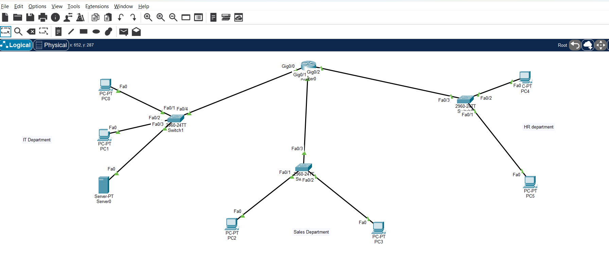
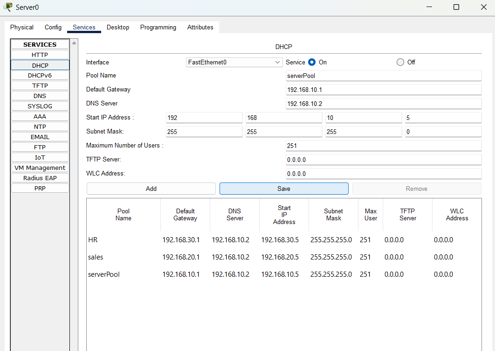
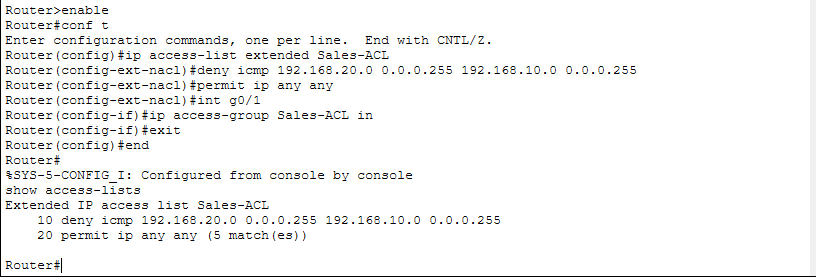
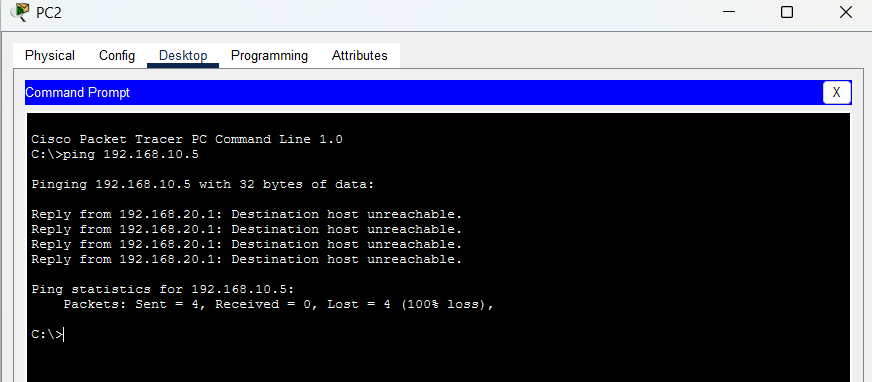
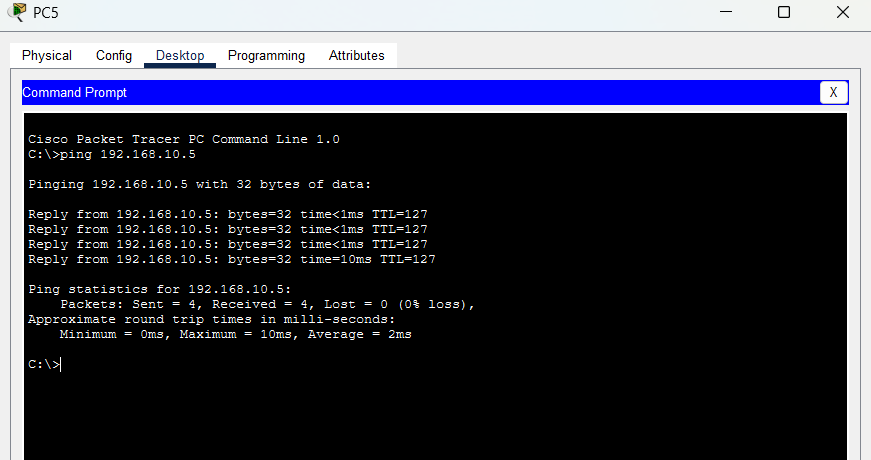
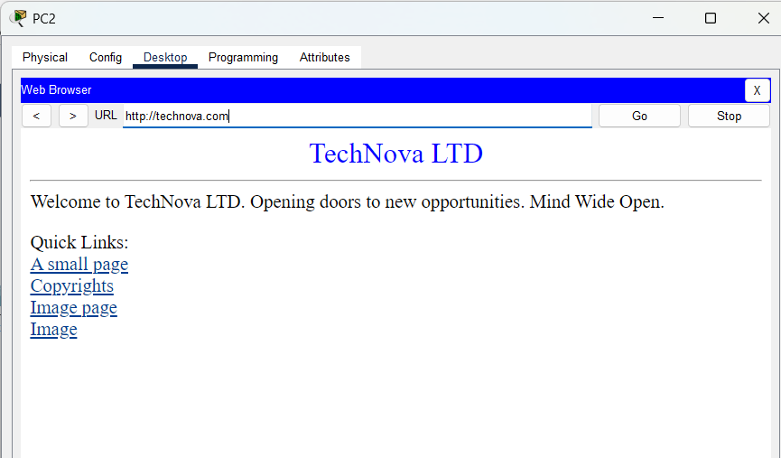

# TechNova: Departmental Network and Access Control

**Author:** [Bernard Oteng](https://github.com/Bernard-Oteng)  
**Report date:** 2 October 2026  
**Status:** Implemented and documented; validation gaps and a DHCP pool correction remain  
**Platform:** Cisco Packet Tracer

## Project Overview

I built a simulated corporate network connecting IT, Sales, and HR through a central router. The lab provides departmental addressing, centralized services, and an access control list that restricts Sales-to-IT ICMP while permitting other IP traffic.

## Network Topology

The topology contains **one router, three switches, six PCs, and one IT server**.



| Department | Devices | Subnet | Default gateway |
| --- | --- | --- | --- |
| IT | PC0, PC1, Server0 | `192.168.10.0/24` | `192.168.10.1` |
| Sales | PC2, PC3 | `192.168.20.0/24` | `192.168.20.1` |
| HR | PC4, PC5 | `192.168.30.0/24` | `192.168.30.1` |

The design uses `192.168.10.2` for Server0 and DNS. The report does not include the server's static IP configuration screen.

## Tools and Technologies

- Cisco Packet Tracer
- IPv4 addressing and /24 departmental subnets
- Routing and departmental switches
- DHCP and DNS
- Extended Cisco access control list
- ICMP testing and HTTP access
- FTP service configuration

## Implementation

### 1. Configure departmental addressing

The report captures DHCP-selected client settings in all three departments:

| Client | Address | Subnet mask | Gateway | DNS server |
| --- | --- | --- | --- | --- |
| IT PC1 | `192.168.10.6` | `255.255.255.0` | `192.168.10.1` | `192.168.10.2` |
| Sales PC2 | `192.168.20.6` | `255.255.255.0` | `192.168.20.1` | `192.168.10.2` |
| HR PC5 | `192.168.30.6` | `255.255.255.0` | `192.168.30.1` | `192.168.10.2` |

Server0 has departmental DHCP pools named `serverPool` (IT), `sales`, and `HR`, each beginning at host `.5`.



**Configuration issue:** The displayed maximum of 251 users does not constrain leases to the assignment's `.5-.10` range. Pool limits need correction and retesting; this portfolio does not claim that correction has been applied.

### 2. Configure name resolution and services

The DNS record maps `technova.com` to the lab server at `192.168.10.2`. The report shows HTTP access and an enabled FTP service. A completed FTP client session is not included.

### 3. Apply the Sales access control list

The following configuration is transcribed from the report:

```text
ip access-list extended Sales-ACL
deny icmp 192.168.20.0 0.0.0.255 192.168.10.0 0.0.0.255
permit ip any any
exit
interface g0/1
ip access-group Sales-ACL in
```



The ACL is applied **inbound on GigabitEthernet0/1**, the Sales-facing interface. It denies all ICMP matching Sales as the source and IT as the destination, then permits other IP traffic.

The restriction is broader than echo requests: matching ICMP echo replies are also denied. HTTP and FTP use TCP and therefore fall through to the permit rule. The shown permit counter has five matches; the capture does not show a deny count.

## Validation Results

| Test | Observed result | Evidence |
| --- | --- | --- |
| Sales PC2 to IT host `192.168.10.5` | 4 sent, 0 received; 100% loss | Report p. 8 |
| HR PC5 to IT host `192.168.10.5` | 4 replies; 0% loss | Report p. 8 |
| Sales PC2 opens the lab website | Website displayed successfully | Report p. 9 |
| FTP client login or transfer | Not demonstrated | Service configuration only |

### Sales-to-IT ping



### HR-to-IT ping



### Sales HTTP access



Together, the captures support the Sales ICMP restriction, continued HR-to-IT connectivity, and successful Sales HTTP access.

## Design Rationale

- Separate subnets organize departmental addressing and local broadcast domains.
- The router connects the different IP networks and provides a point for access control.
- A consistent server address gives DNS and application services a predictable endpoint.
- DHCP reduces repetitive client configuration.
- Protocol-specific ACL rules can block ICMP while allowing TCP applications.

## Limitations and Next Steps

- Correct the DHCP pool limits to match the intended assignment range and verify new leases.
- Capture an FTP login and transfer to demonstrate application access.
- Add the missing pre-ACL and HR-to-Sales connectivity tests.
- Capture the server's static IP settings and relevant router interface/DHCP relay configuration for reproducibility.
- Test the effect of the broad ICMP rule on IT-initiated ping replies from Sales.

## Evidence Source

Adapted from my 11-page `TechNova_Network_Corporate_Designed.pdf` report. The included images were extracted from pages 2, 6, 7, 8, and 9. Client addressing is documented on pages 3-5, and design rationale on pages 10-11.

The original Packet Tracer project file was not supplied with this portfolio update. The lab was not rerun for this write-up.

[Back to portfolio](../../README.md)
